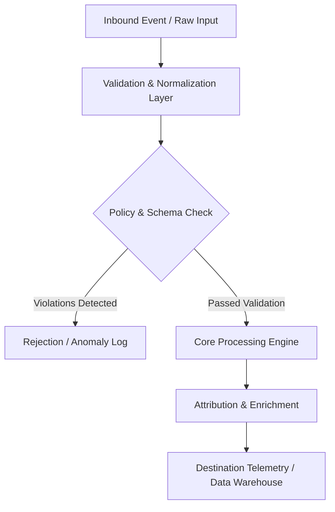

# Universal Taxonomy Spec

## Architecture Specification: Ad Creative Naming Taxonomy Governance & Linter
This document defines the technical architecture and event flow for **Ad Creative Naming Taxonomy Governance & Linter** within the **media-buying** domain.

### Operational Context
Build an ad naming governance and validation toolkit: 1) Universal ad naming taxonomy specification (`[Channel]_[Objective]_[Audience]_[Angle]_[Format]_[Date]`), 2) Pure Python linter script (`taxonomy_linter.py`) that audits CSV ad exports and flags invalid names, 3) Interactive Excel/Sheets formula generator for building valid names, 4) Integration guide for automated Slack/Discord notifications.

---

## System Architecture & Data Flow

## Functional Components

### 1. Ingestion & Normalization Layer
- Captures raw telemetry, webhooks, or file exports.
- Strips whitespace, normalizes regional casing, and sanitizes phone numbers and email strings into E.164 and SHA-256 formats.

### 2. Processing & Business Logic Rules
- Applies deterministic rule engines or statistical models without external black-box dependencies.
- Handles missing or delayed event attributes using bounded lookback windows.

### 3. Output Delivery & Error Handling
- Returns structured JSON payloads with machine-readable error codes and status telemetry.
- Employs exponential backoff retry logic (3 attempts: 1s, 5s, 15s) for downstream webhook delivery.

---
*Operational standard maintained by @mahmoudabdelnaby1.*
